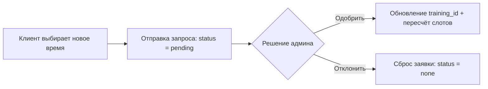

<div align="center">

# 🏋️‍♂️ Run Fit
### Интеллектуальная система онлайн-записи и управления спортивным центром

[](https://react.dev/)
[](https://vitejs.dev/)
[](https://supabase.com/)
[](https://vercel.com/)
[](https://capacitorjs.com/)

<p align="center">
  Современное <b>Single Page Application (SPA)</b> с поддержкой синхронизации данных в реальном времени, ролевой моделью доступа и адаптивным интерфейсом для десктопов и мобильных устройств.
</p>

</div>

---

## ✨ Ключевые возможности

<table>
  <tr>
    <td width="50%" valign="top">
      <h3>👤 Кабинет клиента</h3>
      <ul>
        <li><b>Интерактивная витрина:</b> просмотр актуального расписания с фильтрацией и live-счётчиком свободных мест.</li>
        <li><b>Умное бронирование:</b> запись в один клик с автоматической блокировкой пересечений по времени.</li>
        <li><b>Запросы на перенос:</b> отправка заявки администратору на смену времени тренировки прямо из списка активных записей.</li>
        <li><b>Контроль статусов:</b> отслеживание статуса заявки (ожидание подтверждения) и быстрая отмена брони.</li>
      </ul>
    </td>
    <td width="50%" valign="top">
      <h3>🛠️ Панель администратора</h3>
      <ul>
        <li><b>Управление расписанием (CRUD):</b> добавление, редактирование и удаление тренировок с валидацией занятых мест.</li>
        <li><b>Live-база клиентов:</b> мгновенный поиск по email и просмотр всех активных бронирований пользователя.</li>
        <li><b>Workflow заявок:</b> визуальные уведомления <code>🔔 Запрос на перенос</code>, одобрение или отклонение в один клик.</li>
        <li><b>Авто-пересчёт слотов:</b> при переносе система сама возвращает место на старую тренировку и списывает с новой.</li>
      </ul>
    </td>
  </tr>
</table>

---

## 🔄 Логика работы переноса тренировки (Reschedule Workflow)



---

## 🗄️ Архитектура базы данных (PostgreSQL / Supabase)

Проект построен на реляционной модели с отключённым RLS для быстрого прототипирования и мгновенной работы подписки **Supabase Realtime**:

| Таблица | Назначение | Ключевые поля |
| :--- | :--- | :--- |
| **`trainings`** | Расписание занятий центра | `id`, `title`, `trainer`, `date`, `time`, `max_slots`, `available_slots`, `category` |
| **`profiles`** | Учётные записи и роли | `id`, `name`, `email`, `password`, `role` (`client` / `admin`) |
| **`bookings`** | Бронирования и заявки на перенос | `id`, `user_email`, `training_id`, `requested_training_id`, `reschedule_status` |

---

## 📂 Структура проекта

```text
run-fit/
├── src/
│   ├── components/
│   │   ├── AdminBookings.jsx   # Управление записями клиентов и одобрение переносов
│   │   ├── AdminPanel.jsx      # CRUD-управление расписанием тренировок
│   │   ├── ClientSchedule.jsx  # Личный кабинет клиента и отправка заявок на перенос
│   │   ├── LoginScreen.jsx     # Авторизация и регистрация с валидацией полей
│   │   ├── ScheduleBoard.jsx   # Общая витрина доступных тренировок
│   │   ├── Sidebar.jsx         # Адаптивная навигация (Desktop Sidebar / Mobile TabBar)
│   │   └── Toast.jsx           # Система всплывающих неоновых уведомлений
│   ├── styles/                 # Адаптивные CSS-стили (Mobile-First)
│   ├── supabaseClient.js       # Инициализация клиента Supabase
│   └── App.jsx                 # Главный роутинг и управление состоянием сессии
├── index.html
└── package.json
```

---

## 🚀 Быстрый старт (локальный запуск)

### 1. Клонирование репозитория
```bash
git clone https://github.com/arthurturekulov-official/run-fit.git
cd run-fit
```

### 2. Установка зависимостей
```bash
npm install
```

### 3. Настройка окружения
Создайте файл `.env` в корневой директории проекта и укажите ваши ключи доступа к **Supabase**:
```env
VITE_SUPABASE_URL=https://your-project-id.supabase.co
VITE_SUPABASE_ANON_KEY=your-anon-public-key
```

### 4. Запуск Dev-сервера
```bash
npm run dev
```
Приложение будет доступно по адресу: `http://localhost:5173`

---

## 📱 Кроссплатформенность (Android / iOS)

Интерфейс полностью адаптирован под мобильные экраны (на экранах `< 768px` боковая панель автоматически трансформируется в нижний мобильный Tab-Bar). Проект готов к сборке в нативное мобильное приложение через **Capacitor**:

```bash
npm run build
npx cap sync
npx cap open android
```

---

<div align="center">

### 👨‍💻 Разработчик проекта

**Турекулов Артур Ерланович**  
Группа: **ИС-25-2с**

</div>